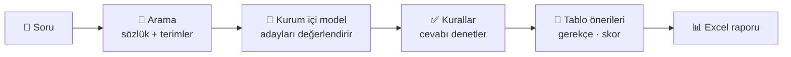

<div align="center">

# 🧭 DWH Navigator

**İş biriminin sorusunu yazın, veri ambarında hangi tablolara bakacağınızı söylesin.**

Doğal dildeki veri taleplerini veri ambarı sözlüğüyle eşleştirir; tablo önerilerini
gerekçesi ve güven skoruyla verir, Excel raporu hazırlar. Kurum içi modelle, kurum içinde çalışır.


</div>

---

## ✨ Ne yapar?

| | |
|---|---|
| 💬 **Soru sor** | "Son 3 ayda kredi kartı başvurusu yapan müşteriler" gibi bir talebi düz Türkçe yazın. |
| 🎯 **Tablo önerisi al** | Uygun tablolar gerekçesi, ilgili kolonları ve güven skoruyla listelenir. |
| 📋 **Toplu liste** | Bir terim listesini yükleyin; her terim tek tek analiz edilir. |
| 📊 **Excel raporu** | Sonuçlar paylaşılabilir bir Excel dosyası olarak iner. |
| 🌌 **Sözlüğü gez** | Tablolar yıldız haritasında; arayın, tıklayın, ayrıntısını görün. |
| 👍 **Geri bildirim** | Cevaba oy verin; yöneticiler kayıtlardan kaliteyi izler. |

## 🔄 Nasıl çalışır?



## 🛠️ Yönetim ekranı

| Sayfa | Ne işe yarar |
|---|---|
| 🏠 **Genel bakış** | Sistemin durumu ve son etkinlik (Ctrl K ile her yere) |
| 📚 **Sözlük** | Ambardan güncelle · Excel'den içe aktar · sürümler ve geri dönüş |
| 🔤 **Kelimeler** | Terim sözlüğü ve durak kelimeler, Excel ile içe/dışa aktarma |
| 🤖 **Yapay zekâ** | Model bağlantıları ve seçimi |
| ⚙️ **Arama ve cevap** | Modelin okuyacağı malzeme ve arama ipuçları |
| 🧾 **Analizler · LLM kayıtları** | Sorulan sorular, model çağrıları |
| 👥 **Kullanıcılar** | Hesaplar ve roller |
| 🧰 **Bakım** | Arama indeksi ve önceki cevaplar |

## 🚀 Hızlı başlangıç

```bash
scripts/bootstrap.sh                      # ilk kurulum
scripts/stack.sh up -d --build --wait     # yerel yığını başlat
scripts/db.sh apply                       # veritabanı şeması
scripts/create-super-admin.sh             # ilk yönetici
```

Sonra tarayıcıda **http://localhost:8080** adresini açın.

<details>
<summary>🧪 Testleri çalıştırma</summary>

```bash
# Arka uç
sh scripts/stack.sh exec -T -e RUN_POSTGRES_INTEGRATION=1 backend sh -lc \
  'export DWHNAVIGATOR_DATABASE_URL="${DWHNAVIGATOR_DATABASE_URL%/*}/dwhnavigator_test"; cd /workspace/app/backend && pytest -q -p no:cacheprovider'

# Ön yüz
sh scripts/stack.sh exec -T frontend sh -lc 'npm run -s typecheck && npx vitest run --maxWorkers=2'
```

</details>

## 🗂️ Depo yapısı

```text
app/backend    → FastAPI arka uç, analiz motoru
app/frontend   → React + Vite ön yüz
app/infra      → Docker Compose yerel yığın
helm/          → Kubernetes dağıtımı
specs/         → gereksinimler (PRD) ve API sözleşmesi
docs/          → teknik rehber ve raporlar
```

## 📖 Daha fazlası

- 🔧 [Teknik rehber](docs/teknik-rehber.md) — dağıtım, imaj yayını, Helm, yönetişim ayrıntıları
- 📐 [Gereksinimler](specs/README.md) — PRD'ler ve kabul ölçütleri
- 📈 [Model kıyas raporları](docs/reports/) — yerel modellerin ölçümleri
